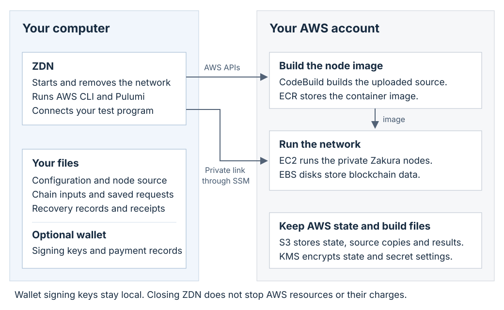

# ZDN

Start a private Zcash test network in your AWS account. Use it to test an
application or try wallet payments. When the test is complete, remove the network
and its AWS resources.



ZDN runs on your computer. AWS runs the nodes and stores their blockchain data.
Keep your local recovery records and wallet backups; AWS state is not a wallet backup.

**Experimental preview. Do not use real funds or a production AWS account.**
Use a dedicated development account with trusted operators. AWS resources cost
money. Wallet files and backups contain plaintext secrets.
Without external restrictions, deployment credentials can read or cancel other
SSM commands in the same region.
See [permission limits](docs/aws-state.md#permissions-and-recovery).

## Start here

**Install from source (free):** use the [manual or source-building Homebrew path](docs/install-source.md)
for the controller and optional separate Ironwood wallet. No Apple signing
credentials are required. Source builds do not qualify the browser downloads.

**First network:** [choose your node input](#choose-your-node-input), then follow
the [quick start](#quick-start-start-a-network-try-it-tear-it-down) and
[setup reference](#setup-and-operating-reference) for AWS access, launch inputs
and cleanup.

**Using an agent:** start with [agent operating instructions](docs/automation.md#agent-operating-checklist).
Use the installed CLI's command schema, preserve operation IDs and receipts,
and require approval before billed or destructive work.

**Looking for a specific task?** Use the [documentation index](docs/README.md)
for payments, application connections, recovery, updates and removal.

ZDN CLI payments use a separate Ironwood wallet program. Network management
accepts a supported Testnet reward address without a wallet backend.
Do not select an address whose rewards you need to spend unless you control its key.

You need Git, AWS CLI v2 and the AWS Session Manager plugin. ZDN installs its
pinned Pulumi tools. You do not need local Docker for the remote source-build
path. See [requirements](#requirements-and-build).

## Choose your node input

ZDN runs Zakura in Linux x86-64 containers on AWS. You can supply your own
Git checkout and Dockerfile, or prepare a container using a Zakura-hosted binary.
All paths must satisfy the [node image contract](docs/image-contract.md), including
the custom-Testnet configuration and diagnostic RPCs; an arbitrary upstream
release is not automatically compatible.

### Your Git checkout

Set `NODE_SOURCE` to the physical Git root of your Zakura checkout. ZDN captures
tracked working files, including local edits, without requiring a commit or push:

```bash
zdn init --name demo --source "$NODE_SOURCE" --nodes 1
```

The default recipe is `docker/Dockerfile`, with the repository root as build
context and `runtime` as the target. Add `--revision "$NODE_REV"` to capture an
exact commit instead of working files. See [source capture](docs/source-capture.md).

### Your Dockerfile

Keep the Dockerfile and its build inputs inside the selected Git checkout.
Select the recipe and context relative to that checkout's root:

```bash
zdn init --name demo --source "$NODE_SOURCE" --nodes 1 \
  --dockerfile path/to/Dockerfile --build-context .
```

These are alternative `init` commands, not sequential steps. For either source
path, `zdn devnet render` previews the build contract locally; `zdn up` reuses an
exact verified image or builds the `runtime` target in AWS CodeBuild. See
[source-to-image builds](docs/builds.md#4-cli-integration).

### Zakura-hosted binaries or your own compiled binary

Obtain and verify a Linux x86-64 binary from [Zakura](https://zakura.com/download/),
or use your own compiled binary. **ZDN does not directly download or deploy a
bare node executable.** Package it at `/usr/local/bin/zakurad` in a compatible
Linux/amd64 image, publish that image to your team's ECR repository, and select
its immutable child-manifest digest:

```bash
zdn init --name demo --nodes 1 --image "$NODE_IMAGE"
```

Set `NODE_IMAGE` to `ACCOUNT.dkr.ecr.REGION.amazonaws.com/zdn/TEAM/zakura@sha256:DIGEST`,
replacing every placeholder. Supply the image record, exact registry manifest
and configuration bytes with `--image-record`, `--image-manifest` and
`--image-config` on the first render or launch. This path skips the ZDN source
build. Follow the [existing-image deployment steps](docs/private-devnet.md#deploy)
for the complete command and required chain, helper and AWS inputs.

## Quick start: start a network, try it, tear it down

For your first network, use the default local profile (`devnet`), state directory
and configuration file (`devnet.yaml`). Complete the release's account and
source setup first, then run the commands below from a new working directory.
Set the six launch inputs in [the setup table](#keep-the-original-inputs-and-private-state).
Keep the same shell and saved files through cleanup.
Always select a Linux x86-64 executable for `HOST_HELPER`:

| Your computer | Controller and helper |
| --- | --- |
| Linux x86-64 | Run the Linux controller. Use the release-selected Linux executable as helper. |
| Apple Silicon Mac | Build the native controller [from source](docs/install-source.md) and use a separately pinned Linux helper. |

### 1. Start the network

Create the one-node configuration once. The distributed node source uses
`node/zakura/docker/Dockerfile` with the Git root as build context; a standalone
Zakura checkout may use `docker/Dockerfile` instead. Select the reviewed recipe
for your exact source, not a guessed file or a different source revision:

```bash
zdn init --name demo --source "$NODE_SOURCE" --revision "$NODE_REV" --nodes 1 \
  --dockerfile node/zakura/docker/Dockerfile --build-context .
zdn devnet render
```

Require `render` to succeed and review its build contract before binding wallets
or launching. It checks the captured recipe without building or contacting AWS;
it does not prove the image builds or the network works.

For optional payments, [create the reward wallet before launch](docs/wallet.md#2-create-the-local-reward-wallet-before-launch)
and use its reward address for `REWARD_ADDRESS`. These coins are test ZEC, not
real funds. Otherwise use a supported Testnet reward address you control.

The next command starts a source build if required, starts one private host and
checks the node. **It creates billed AWS resources.**

```bash
zdn up --manifest "$CHAIN_MANIFEST" --bundle "$CHAIN_BUNDLE" \
  --host-helper "$HOST_HELPER" --ami-id "$AMI_ID" \
  --availability-zone "$ZONE" --reward-address "$REWARD_ADDRESS" --yes
```

Wait for success. If the command fails, keep its state and receipts.
Do not start a replacement network to bypass the failure.

### 2. Check the network

The configuration names this network `demo`. Select that saved label explicitly
(or use the full network ID returned by `up`). Check health and block height:

```bash
zdn devnet health demo
zdn rpc demo getblockcount
```

### 3. Send test ZEC (optional)

After your pre-created reward wallet has mature rewards, create `alice` and `bob`,
fund Alice, then send 0.1 test ZEC to Bob. See [the first-payment walkthrough](docs/wallet.md#first-payment-alice-and-bob)
for balance and maturity checks. Skip any creation command for wallets you already made:

```bash
zdn wallet backend set --backend "$IW" --backend-sha256 "$IW_SHA256"
zdn wallet create demo --name alice
zdn wallet create demo --name bob
zdn fund demo --wallet alice --amount 1
zdn send demo --from alice --to bob --amount 0.1
```

`IW` is your trusted Ironwood wallet program; `IW_SHA256` is its independently
verified hash. Configure the pair once; ZDN rechecks executable bytes on each use.
The explicitly selected deployment supplies the reviewed manifest, with matching
endpoint and wallet fingerprints. Keep the payment operation ID printed by
the command. If a reply is lost, [resume that operation](docs/wallet.md#durable-funding-payments-and-status)
rather than starting another payment. To connect an application instead, see
[connections](docs/connections.md).

### 4. Tear down the network and disposable team

Stop all local connections, controllers and programs that write data.
Back up the whole wallet store if you need it. Keep the original receipts.

**The following commands delete owned network data, build artifacts and team
state. Use them only for the disposable team you created for this test.**
Do not use them to remove a shared team. Remove separate participant grants first,
if you created any. Read [removal](docs/removal.md) before you continue.

```bash
set -e
zdn devnet destroy demo --yes --delete-data
zdn setup remove-team --aws-profile "$AWS_PROFILE" \
  --yes --delete-data --writers-stopped
```

Run each command only after the previous command succeeds. A failed cleanup is
not a completed cleanup. Keep the state for inspection and recovery.

Closing a terminal does not turn off the network. Network removal without
`--delete-data` retains data. Network removal alone also leaves team resources.
Retained resources can cost money. Final team removal schedules KMS key deletion
after 30 days. That schedule is not physical deletion or proof that billing has ended.

## Preview limits

- Use an isolated custom Testnet. This is not Mainnet or public Testnet activation.
- The one-node example uses a 25-second scheduled block target.
  Proof of work is disabled. This is not a public-network security test.
- ZDN uses a trusted node. It is not a consensus light client or a production wallet.
- See the selected release's notes for exact downloaded-file checks and
  [preview scope](docs/preview.md).
- Checksums check bytes. They do not prove publisher identity or legal clearance.
  The release notes retain the license and Apple SDK rights limits.

## Setup and operating reference

Use this section when you need the individual setup inputs and recovery rules.
For a first run, start with [node inputs](#choose-your-node-input) and the
[quick start](#quick-start-start-a-network-try-it-tear-it-down).
Agents operating ZDN should read [automation](docs/automation.md); contributors
changing this repository should also read [AGENTS.md](AGENTS.md).

ZDN builds and starts Zakura nodes. It provides private connections and records
operations for recovery. Zakura checks the blockchain. A separate wallet program
holds keys and signs payments.

### Requirements and build

Install Git, AWS CLI v2 2.37.4 or later, and the native AWS Session Manager plugin.
Install managed tools before you require a ready doctor result:

```bash
zdn deps install --noninteractive
zdn doctor
```

`doctor` checks local prerequisites. It does not sign in or check AWS identity
or permissions. A ready result does not authorize a deployment.
See [managed dependencies](docs/dependencies.md).

For an installed release build, follow [source installation](docs/install-source.md)
(manual or Homebrew), including the separate optional wallet. For development,
use the Rust toolchain in `rust-toolchain.toml`:

```bash
cargo build --locked
```

Use `target/debug/zdn`, or add `target/debug` to your `PATH`.
This is an independent Rust workspace. Do not add node, wallet-proof or research
workspace dependencies to it.

### Set up AWS access

Use one authenticated, administrator-capable, non-root AWS profile for setup
and final team removal. Use a dedicated development account. Setup creates
deployment and runtime roles. Normal commands use the recorded deployment role
through the same source login.

Replace every placeholder before you run this setup example:

```bash
zdn setup bootstrap --aws-profile "$AWS_PROFILE" --trust-principal "$TRUST_PRINCIPAL" \
  --team-id "$TEAM" --account-id "$ACCOUNT_ID" --region "$REGION" \
  --bucket "$BUCKET" --export "$WORK/team.yaml" --yes
```

Use the exact IAM user or role ARN for `TRUST_PRINCIPAL`. Do not use an STS session
ARN. Setup does not grant administrator access to the source identity.
Refresh that login through the normal AWS login process when it expires.
See [account setup and permissions](docs/aws-state.md#one-time-account-access).

**Deployment credentials do not isolate unrelated teams in one account.**
The deployment role permits regional `ssm:ListCommands`,
`ssm:GetCommandInvocation` and `ssm:CancelCommand` on `Resource: "*"`.
Without external restrictions, those credentials can list, read output from,
or attempt to cancel commands beyond ZDN-tagged hosts. CLI filters do not limit
direct credential use. Cancellation does not prove that the remote process
stopped. This exception is not a participant-role or node-runtime-role grant.
See [permission limits](docs/aws-state.md#permissions-and-recovery).

An existing team can share its credential-free export. Import does not grant
AWS access. A separate participant needs their own identity and an explicit
grant. See [team setup](docs/aws-state.md) and [participant access](docs/connections.md).

### Keep the original inputs and private state

The lifecycle example uses the `devnet` local profile and `devnet.yaml` in the
current directory. State is saved under `$XDG_DATA_HOME/zdn/state`, or
`$HOME/.local/share/zdn/state` when `XDG_DATA_HOME` is unset. Keep that directory
outside captured source. Obtain exact file names and hashes from the selected
release; do not substitute historical assets.

Set these six inputs before the first launch:

| Variable | Required value |
| --- | --- |
| `CHAIN_MANIFEST`, `CHAIN_BUNDLE` | Verified consensus manifest and its matching saved-block bundle. |
| `AMI_ID`, `ZONE` | Available Amazon Linux 2023 x86-64 image and a zone that supports the chosen host. |
| `REWARD_ADDRESS` | Supported transparent Testnet reward address. A ZDN funding wallet is optional; keep its whole store if you create one. |
| `HOST_HELPER` | Release-selected, verified Linux x86-64 helper. Never the Mac executable. |

Account/source setup also uses these values:

| Variable | Required value |
| --- | --- |
| `WORK` | New private work directory, outside captured source. |
| `NODE_SOURCE`, `NODE_REV` | Physical Git root and exact revision of the selected, verified node source. A curated tree has its own identity. |
| `NETWORK` | Explicit saved label (such as `demo`) or network ID returned by `up`. Reuse it for health, RPC, cleanup and recovery. |
| `TEAM`, `AWS_PROFILE` | AWS team ID and the authenticated administrator source AWS profile. The local ZDN profile remains `devnet`. |
| `TRUST_PRINCIPAL`, `ACCOUNT_ID`, `REGION`, `BUCKET` | Reviewed account, login and new team-backend settings. |

For multiple networks or custom locations, use `--config PATH` on launch and
`--profile NAME` / `--state-dir PATH` where supported. Set the configuration's
`profile` to the selected local profile. Use the same profile and state directory
through setup, use and cleanup; the short examples assume the defaults above.
`--reconcile` is for recovering an interrupted or uncertain operation, not an
extra first-run requirement. Follow the recovery instructions before adding it.

On Mac, use the release instructions for a short, private, physically resolved
`TMPDIR` under `/private/tmp` and a real socket-path check. Do not derive `TMPDIR` from
`WORK` or weaken symlink and permission checks. Keep it until all commands and
cleanup finish. Do not force-delete a nonempty temporary directory.

Use exact chain, backend, helper and source hashes. Source capture can include
tracked working changes and staged additions. Prefer an explicit revision for
repeatable inputs. Keep wallets, credentials, logs and state out of source capture.
See [source capture](docs/source-capture.md), [source builds](docs/builds.md),
[chain manifests](docs/chain-manifest.md) and [saved chain bytes](docs/chain-artifacts.md).

Generic `zdn init` defaults differ from `zdn init --nodes 1`. It selects three
medium nodes and the node-only service preset. It does not deploy a wallet or
faucet service. Optional lightwalletd needs its own pinned image inputs.
Configuration checks do not test a running node or wallet payments.
See [compatibility](docs/compatibility.md) and [lightwalletd](docs/lightwallet.md).

### Connect your application

```bash
zdn exec "$NETWORK" -- ./my-integration-test
```

Replace `./my-integration-test` with your program. ZDN supplies `ZDN_RPC_URL` to
the program and closes the connections when it exits. The AWS network keeps
running. See [connections](docs/connections.md).

### Read results before you continue

- `devnet list` reads local records. It does not check AWS resources.
- `devnet status` reads inventory. It does not check current node readiness.
- `devnet health` makes new readiness checks. It does not repair a node.
- `connect` keeps private tunnels open. Closing it does not stop the network.
- `exec` checks connections before it starts your program. It is not a sandbox
  for untrusted code. A cleanup failure can override the program's exit status.
- `rpc` makes one allowed read-only request. `submit` sends already-signed bytes.
  A failed submission or tunnel cleanup does not prove that payment was rejected.

Put root `--format json` or `--format jsonl` before a supported command.
Read the terminal result and its retry classification. Machine output and
`--noninteractive` do not grant mutation consent. Not all commands support these
formats. Use the separate event channel for `exec`.
See [automation](docs/automation.md) and [connections](docs/connections.md).

### Recover without duplicate effects

Keep the same network, input hashes, operation IDs and receipts after a failure.
Inspect saved state before you dispatch more work. A local timeout does not prove
that AWS stopped. A missing reply does not prove that nothing happened.

For an unchanged saved node request, the documented recovery command is:

```bash
zdn up --saved "$NETWORK" --yes --reconcile
```

This is a recovery command, not the first-launch command. A build can fail before
a node request exists. Inspect its original build receipt and follow
[build recovery](docs/builds.md) in that case.
Do not start a second build, delete a receipt, force-unlock a lease or take over
from another controller to bypass uncertainty.

Use the wallet's original operation ID to resume a payment. Do not create a new
payment as a retry. Preserve reservations and original signed bytes. A key-only
import is scan-only. Stop all writers before you copy the whole wallet store,
including journals and payment data. Private permissions are not encryption.
See [wallet recovery](docs/wallet.md), [controller recovery](docs/private-devnet.md#resume)
and [local state](docs/state.md).

### Remove only resources that the original receipts identify

Use the staged commands in the lifecycle example. Do not replace native removal
with wildcard AWS deletion. Team removal needs the original completed bootstrap
and access receipts. Use the original administrator profile, not the deployment
role being removed.

Stop all writers first. `--writers-stopped` is your statement that they stopped;
it is not a distributed lock. Active or unknown builds, foreign resources,
changed receipts and ownership mismatches require inspection. Cleanup can refuse
large inventories. A refusal can leave billed resources in place.
Do not report KMS PendingDeletion as physical deletion, session revocation or
complete billing closure. See [participant and team removal](docs/removal.md).

### Change code and validate within the approved scope

Run ordinary checks for code changes:

```bash
cargo fmt --all -- --check
cargo test --locked
cargo clippy --all-targets --locked -- -D warnings
```

These tests use local files, processes, Git and loopback servers. They must not
require AWS credentials, live nodes, Docker, downloads or proof generation.
Documentation-only changes need link, command-syntax and diff checks.

Ask for exact scope approval before live AWS validation, node/container builds,
CodeBuild jobs, proof generation or performance workloads. A request to edit or
test code is not that approval. Keep unrun tests marked pending. Do not change CI
triggers to bypass this rule. Read [AGENTS.md](AGENTS.md) and [testing](docs/testing.md).

Maintainers preparing a new Mac release should use the
[signing and notarization runbook](docs/macos-release.md), which is prepared but
has not been executed or qualified.

### Detailed reference

| Task | Guide |
| --- | --- |
| Private deployment, topology and readiness | [Deployment](docs/private-devnet.md), [topology](docs/private-topology.md), [bootstrap](docs/bootstrap-readiness.md) |
| Node and host behavior | [Node settings](docs/node-config.md), [runtime settings](docs/runtime-config.md), [host lifecycle](docs/host-lifecycle.md), [block controller](docs/block-producer.md) |
| Image changes and data compatibility | [Updates](docs/updates.md), [image contract](docs/image-contract.md) |
| Artifact and publisher checks | [Packages](docs/packages.md), [release verification](docs/releases.md) |
| Optional lightwalletd | [Deployment](docs/lightwallet.md), [service contract](docs/lightwallet-service.md), [compatibility](docs/lightwalletd-compatibility.md) |
| Infrastructure without a blockchain | [Foundation](docs/infrastructure.md), [foundation lifecycle](docs/foundation-lifecycle.md), [Pulumi](docs/pulumi.md) |
| Timing and diagnostics | [Deployment execution](docs/deployment-performance.md), [tracing](docs/profiling.md) |
