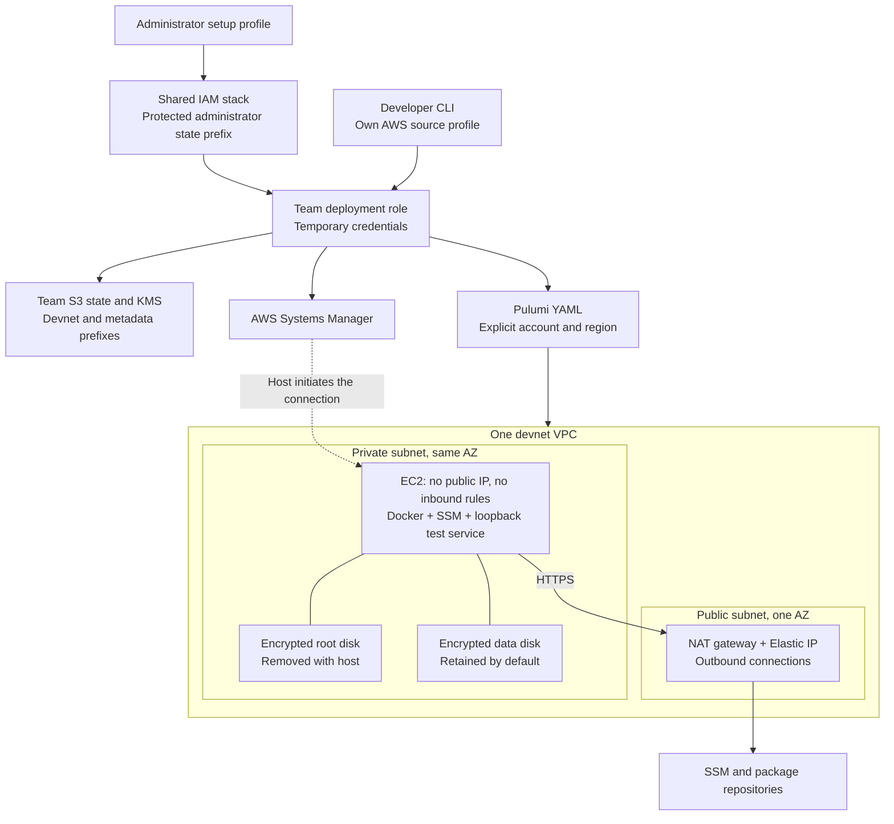

# AWS foundation

The foundation is an **optional, billed infrastructure smoke test**, not a
prerequisite for a blockchain network. For normal use, follow
[installation and network launch](preview-start.md) instead.
Complete [AWS setup](aws-state.md) before using either workflow.

The foundation creates one private EC2 host for a small readiness test. It does
not start Zakura, mine blocks, build images, or run wallet services. Live
qualification must cover creation, inspection, updates without replacement,
and removal of this host.



## Run the foundation

Complete account setup and managed dependency installation first. Select an
exact AMI ID from the chosen AWS region and an Availability Zone that offers
the selected instance type. Set `HOST_HELPER` to the verified Linux x86-64
executable selected by your [public release profile](preview-start.md#1-select-and-verify-a-profile).
It is required for both render and up, even when the controller runs on a Mac;
do not substitute a macOS executable.

```sh
zdn foundation render --config devnet.yaml --ami-id ami-REPLACE \
  --availability-zone us-east-1a --host-helper "$HOST_HELPER"
zdn foundation up --config devnet.yaml --ami-id ami-REPLACE \
  --availability-zone us-east-1a --host-helper "$HOST_HELPER" --yes
zdn foundation status NETWORK_ID
zdn foundation destroy NETWORK_ID --yes
```

Replace `ami-REPLACE` and `NETWORK_ID` with the actual identifiers. Render is
offline. Up provisions billable resources and waits for the harmless service.
The diagram shows version 2 deployment-role access; legacy team profiles use
their configured AWS identity directly. The normal destroy command retains the data disk. Add `--delete-data` to delete
that disk after infrastructure teardown. Foundation commands do not launch a
Zcash chain.

## Inputs and resource identity

`FoundationSpec` fixes the AWS account, region, profile, team, full network UUID,
AMI ID, Availability Zone, size, and disk-retention policy. The renderer makes no
AWS calls. The caller must check the AMI and Availability Zone with AWS before
apply. The AMI must be an available Amazon Linux 2023 image for x86-64, with an
EBS root device and the expected Amazon publisher. Moving image aliases and SSM
parameter references are not accepted as AMI IDs. The bootstrap also checks the
running operating system and architecture.

The first foundation supports standard AWS regions. China regions, GovCloud,
Local Zones, and multi-AZ deployment need separate qualification.

Every resource name contains the full network UUID and its purpose. User labels
do not affect resource identity. Tags record the team, network ID, and resource
purpose. No existing resource is adopted based on a matching name.

The generated program uses typed resource properties, stable map ordering, and a
pinned AWS provider version. Each AWS resource selects the same explicit
provider, which sets the allowed account ID, region, and profile. Rendering
rejects missing resource references, unknown referenced output fields, and
resource dependency cycles. These checks do not replace the Pulumi schema and
provider checks. See the [Pulumi YAML resource and provider contract](https://www.pulumi.com/docs/iac/languages-sdks/yaml/yaml-language-reference/).

## Network and host permissions

Each foundation has its own `10.90.0.0/16` VPC. The public subnet uses
`10.90.0.0/24`; the private subnet uses `10.90.1.0/24`. These VPCs are not peered.
The public subnet contains the NAT gateway, not the host. Only the NAT gateway
has a public address. The host has no SSH key and no inbound security-group
rules. Its service listens on `127.0.0.1:18080`. Version 1 also clears the default
VPC security group. Version 2 leaves that AWS-created group unmanaged; no zdn
host uses it. This permits strict ownership checks on security-group mutations.

The private subnet routes outbound traffic through the NAT gateway. The host
security group permits outbound TCP 443 for SSM and distribution packages.
The NAT and public route must exist before the private host starts. VPC DNS is
enabled. There is no public client endpoint or load balancer.

The instance role uses `AmazonSSMManagedInstanceCore`. It has no state-bucket,
KMS state-key, ECR, or CodeBuild policy. Version 2 adds the shared runtime permissions boundary and a bootstrap-specific
IAM path. The operator assumes the deployment role for state and infrastructure
operations; the EC2 instance cannot assume that role. The host requires IMDSv2 and uses a
metadata hop limit of one. See the [instance metadata properties](https://www.pulumi.com/registry/packages/aws/api-docs/ec2/instance/).

## Host setup and readiness

Host setup installs `docker`, `awscli-2`, `amazon-ssm-agent`, `e2fsprogs`, and `util-linux`. It
starts Docker and the SSM agent, then waits for the separately attached data
volume. The volume ID selects its NVMe device. Setup formats a blank owned
volume as ext4, preserves an existing ext4 filesystem, and rejects an unknown
filesystem. The mount uses its filesystem UUID and is restored at boot.

A pinned native Rust helper provides `/health` on localhost.
It checks Docker, SSM, the data mount, and effective host capacity on each
request. It returns the network UUID and a versioned JSON readiness record.
A setup marker is useful for diagnosis but is not the live readiness check.
No container image is downloaded or built for this test. Docker must report a
working daemon before readiness succeeds.

The fixture uses one 256 MiB memory budget and one quarter of a CPU per devnet.
It runs under systemd with a memory limit, CPU quota, a read-only system
filesystem, and a restricted write directory. Host setup and service logs are
available through the instance's normal cloud-init and systemd logs.

| Size | Instance | Host reserve | Data disk | Root disk |
| --- | --- | --- | --- | --- |
| Small | `m7a.large` | 2 GiB | 40 GiB | 32 GiB |
| Medium | `m7a.xlarge` | 2 GiB | 80 GiB | 32 GiB |
| Large | `m7a.2xlarge` | 4 GiB | 160 GiB | 32 GiB |

Resolve memory from Linux `MemTotal` and every finite parent cgroup limit, then
subtract the host reserve and the fixture budget. Cap the remainder at the
selected size's application limit. Resolve CPU from online/affinity visibility
and parent quotas. Reserve one quarter of a CPU for host services and one
quarter for the fixture. Fail if these reservations do not fit. The readiness
record reports the measured limits; nominal instance RAM is not a measured
application budget. These allocations remain unqualified for Zakura.

## Outputs and teardown

`FoundationOutputs` has schema version 1. It contains the exact team/account/
region scope and network UUID, plus the AZ, VPC, private subnet, host, private
address, security group, data volume, NAT gateway, and Elastic IP allocation
IDs. It also records the retention policy. The parser requires every field,
rejects unknown fields, verifies the request scope, and rejects a host address
outside the private subnet. A partial Pulumi update must not produce a success
receipt from incomplete outputs.

The root and data volumes use encryption. The independent data volume uses gp3
with 3,000 IOPS and 125 MiB/s. It is not an inline instance block device.
Attachment removal stops the host before detaching and never forces detach;
see the [volume-attachment contract](https://www.pulumi.com/registry/packages/aws/api-docs/ec2/volumeattachment/).

Normal teardown removes the host, root disk, role, profile, network rules,
subnets, routes, NAT gateway, Elastic IP, and VPC. The data volume is retained
and removed from Pulumi management. Preserve its ID before destruction. With an
explicit data-deletion request, the caller first finishes Pulumi destruction,
then checks that the tagged retained volume is detached before deleting it.
Do not run an apply during teardown merely to change disk retention.

Retaining a disk is not a backup or an automatic restore feature. Record the
volume ID and AZ for recovery. A new deployment must not silently attach it.
The team state bucket and KMS key are separate shared resources and survive
network teardown.

Cleanup searches by ownership tags and directly checks all resource IDs saved
in the foundation outputs. A known Elastic IP or other resource cannot disappear
from the report because its tags changed. Changed ownership needs inspection;
the saved ID alone does not authorize deletion.

The NAT gateway, public IPv4 address, EC2 host, and both disks add charges. The
NAT gateway also charges for processed traffic. Its fixed cost can be a large
part of a one-host test. Retained disks continue to cost money after the network
is removed. The network uses one NAT gateway. Use the
selected region's current [AWS VPC pricing](https://aws.amazon.com/vpc/pricing/)
and EC2/EBS rates before launching.

For contributor checks, see the [test coverage notes](testing.md#subsystem-coverage-notes).
