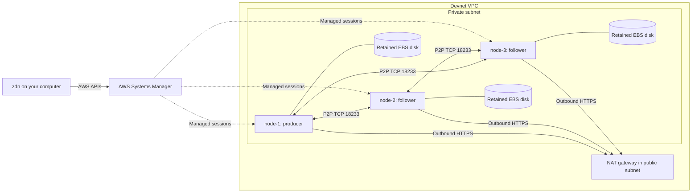

# Private Zakura topology

The private topology supports one to three Zakura nodes. Each node has its own
EC2 instance and encrypted EBS data disk. All nodes share one VPC, one private
subnet, and one NAT gateway in the selected availability zone.

The diagram shows the three-node form. A one-node deployment uses only node-1.
Node-1 has the producer role. This role permits mining readiness checks; it does
not start a block controller by itself. The [private deployment flow](private-devnet.md)
activates the [controller](block-producer.md) after all nodes pass fresh readiness.

## Addresses and access

| Node | Private IP | Role | Data resource |
| --- | --- | --- | --- |
| node-1 | 10.90.1.10 | Producer | chainDisk |
| node-2 | 10.90.1.11 | Follower | chainDisk2 |
| node-3 | 10.90.1.12 | Follower | chainDisk3 |

Addresses are fixed inside each devnet's separate VPC. They let zdn render peer
configuration before AWS creates the hosts. Separate devnets can use the same
addresses because their VPCs are isolated. This layout does not configure VPC
peering or cross-devnet routing.

The host security group accepts TCP 18233 only from the selected nodes' exact
private addresses. It allows outbound P2P to those addresses and outbound HTTPS
for AWS APIs, SSM, and package/image downloads. Instances have no public IP, SSH
key, SSH ingress, or remote RPC ingress. RPC stays on each host's loopback address
and requires its private node cookie. SSM carries management commands and local
client connections; it does not require an inbound security-group rule.

## Storage, capacity, and ownership

Every host uses the selected size's instance type, root-disk size, and chain-disk
size. The [host lifecycle](host-lifecycle.md) applies the container's memory and
CPU limits. Root disks are encrypted and deleted with their instance. Chain disks
are separate encrypted gp3 volumes with 3,000 IOPS and 125 MiB/s throughput. Pulumi
retains them on deletion. Each attachment stops its instance before detaching and
does not force detach.

Resource names contain the full deployment UUID. Node-1 keeps the foundation's
`host`, `chainDisk`, and `chainAttachment` keys. Later nodes use suffixes `2` and
`3`. Each host and disk also has a `zdn:node-id` tag. The topology inherits the
foundation program's team/bootstrap ownership tags, constrained IAM role,
permissions boundary, provider account guard, and protected root-volume tag
handling. It does not create another deployment role.

Host user data installs prerequisites. The deployment workflow installs the
selected node image and artifacts through SSM after AWS attaches each data disk.
Rendering does not create cookies, upload source, build an image, or run a node.
Node installation and readiness are separate from EC2 creation.

## Outputs and update limits

Stack outputs retain the existing first-host fields and add a `nodes` map. Each
entry contains `node_id`, `instance_id`, `private_ip`, and `volume_id`. Parsing
requires the exact requested node set, the expected address for each node, and
distinct instance and volume IDs. These checks do not prove AWS ownership or
readiness; the deployment workflow must check both against live resources.

Cleanup queries every saved instance and volume ID even if ownership tags are
missing. A cluster disk is eligible for explicit data deletion only when its ID
matches the saved node outputs and its deployment, team, node, name, and managed
bootstrap tags still match. Unknown or changed disks remain reported as resources
that require attention. Tags alone cannot authorize cluster-disk deletion when
the node outputs were not saved.

The initial deployment path requires a fresh cluster. It must not convert an
existing foundation health-test host into a Zakura host. Pulumi's preview and
saved-plan checks still apply. A normal apply must reject deletion or replacement.
Host user-data changes can require instance replacement, so they are not the
binary-update path. Later branch iteration must use an explicit node update
workflow.

## Checks

`cargo test --locked --test cluster_infra` checks resource shape, references,
firewall membership, private addresses, IAM inheritance, retained storage,
resource budgets, setup-script bounds, and output identity. It uses no AWS or
Docker. An offline render is not proof that the provider accepts the program or
that the node image runs on EC2. Live single-node, multi-node, restart, and
late-join checks must record separate evidence.
